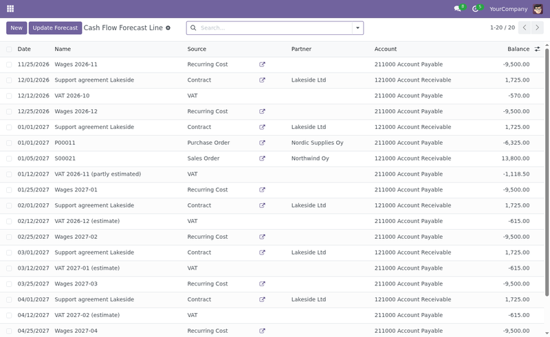
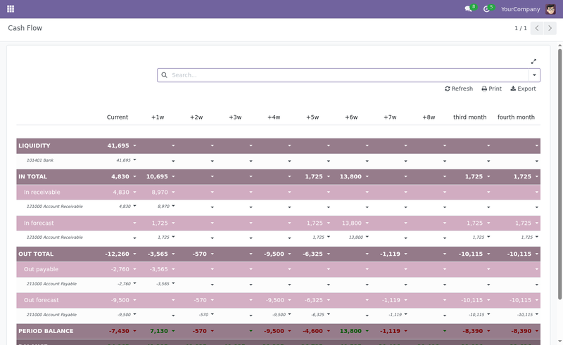

===================================
MIS Builder Cash Flow Auto Forecast
===================================

.. 
   !!!!!!!!!!!!!!!!!!!!!!!!!!!!!!!!!!!!!!!!!!!!!!!!!!!!
   !! This file is generated by oca-gen-addon-readme !!
   !! changes will be overwritten.                   !!
   !!!!!!!!!!!!!!!!!!!!!!!!!!!!!!!!!!!!!!!!!!!!!!!!!!!!
   !! source digest: sha256:dd4926ab4e055f5a7a62e08c9f29c7e1667de6af30d43912d56b6a6a7a556cc7
   !!!!!!!!!!!!!!!!!!!!!!!!!!!!!!!!!!!!!!!!!!!!!!!!!!!!

.. |badge1| image:: https://img.shields.io/badge/maturity-Beta-yellow.png
    :target: https://odoo-community.org/page/development-status
    :alt: Beta
.. |badge2| image:: https://img.shields.io/badge/license-AGPL--3-blue.png
    :target: http://www.gnu.org/licenses/agpl-3.0-standalone.html
    :alt: License: AGPL-3
.. |badge3| image:: https://img.shields.io/badge/github-Cetmix--Nordic--Ltd%2Fcash--flow--forecast-lightgray.png?logo=github
    :target: https://github.com/Cetmix-Nordic-Ltd/cash-flow-forecast/tree/18.0/mis_builder_cash_flow_auto
    :alt: Cetmix-Nordic-Ltd/cash-flow-forecast

|badge1| |badge2| |badge3|

Generates the forecast lines of the OCA *MIS Builder Cash Flow* report
(``mis_builder_cash_flow``) automatically, so that the report shows the
expected payments that are not yet open invoices or bills.

The module adds two sources:

-  **Recurring costs and income**: rules that forecast for example wages
   or rent as the monthly average of chosen accounts over the past
   months.
-  **VAT**: the VAT payment of each VAT period, due on the due date of
   the period. A period that has ended is forecast with the VAT still on
   the VAT accounts; the current and future periods use the average of
   past periods.

Other modules add more sources:

+----------------------------------+----------------------------------+
| Module                           | Source                           |
+==================================+==================================+
| ``m                              | Confirmed sales orders not yet   |
| is_builder_cash_flow_auto_sale`` | invoiced                         |
+----------------------------------+----------------------------------+
| ``mis_b                          | Purchase orders not yet billed   |
| uilder_cash_flow_auto_purchase`` |                                  |
+----------------------------------+----------------------------------+
| ``mis_b                          | Future invoices of OCA contracts |
| uilder_cash_flow_auto_contract`` |                                  |
+----------------------------------+----------------------------------+

The generated lines are updated every day and on request. Forecast lines
entered by hand are never changed.

**Table of contents**

.. contents::
   :local:

Configuration
=============

1. *Invoicing > Configuration > Settings > Cash Flow Forecast*:

   -  **Forecast Horizon**: how many months ahead lines are generated
      (12 by default).
   -  **Forecast VAT Payments**: the VAT period (month, quarter or
      year), the due date (by default the 12th day of the second month
      after the period, as in Finland), how many past periods the
      estimate is averaged over, and the account the VAT lines are shown
      on. When the account is empty, the tax payable account of the
      company's tax groups is used if it is a payable account.

2. *Invoicing > Reporting > MIS Reporting > Recurring Cash Flows*
   (accounting administrators): one rule per recurring cost or income,
   with the accounts to average, the months of history, the expected
   payment day and the receivable or payable account the lines are shown
   on.

Forecast lines are shown in the cash flow report only on receivable or
payable accounts, which is why the rules and the VAT forecast ask for
one.

Usage
=====

1. Open *Invoicing > Reporting > MIS Reporting > Cash Flow Forecast
   Line*. The *Update Forecast* button regenerates the lines now; a
   scheduled action does it every night. |Generated forecast lines|
2. The *Source* column tells where a line comes from, and the link
   button opens its origin (rule, order or contract).
3. Open the *Cash Flow* MIS report: the generated lines are in the *In
   forecast* and *Out forecast* rows, by account. |Cash Flow MIS report|

A month that already has postings on the accounts of a recurring rule is
not forecast, because those postings already are in the cash flow as
open bills or invoices.

Known issues / Roadmap
======================

-  The VAT periods follow the calendar year.
-  The VAT estimate is the average of past periods; it does not use the
   VAT of the forecast sales and purchases.
-  Recurring rules forecast a monthly amount; quarterly or yearly costs
   need a manual forecast line.

Changelog
=========

Bug Tracker
===========

Bugs are tracked on `GitHub Issues <https://github.com/Cetmix-Nordic-Ltd/cash-flow-forecast/issues>`_.
In case of trouble, please check there if your issue has already been reported.
If you spotted it first, help us to smash it by providing a detailed and welcomed
`feedback <https://github.com/Cetmix-Nordic-Ltd/cash-flow-forecast/issues/new?body=module:%20mis_builder_cash_flow_auto%0Aversion:%2018.0%0A%0A**Steps%20to%20reproduce**%0A-%20...%0A%0A**Current%20behavior**%0A%0A**Expected%20behavior**>`_.

Do not contact contributors directly about support or help with technical issues.

Credits
=======

Authors
-------

* Cetmix Nordic Ltd

Contributors
------------

-  `Cetmix <https://cetmix.fi>`__:

   -  Jussi Lehto

Maintainers
-----------

This module is part of the `Cetmix-Nordic-Ltd/cash-flow-forecast <https://github.com/Cetmix-Nordic-Ltd/cash-flow-forecast/tree/18.0/mis_builder_cash_flow_auto>`_ project on GitHub.

You are welcome to contribute.
