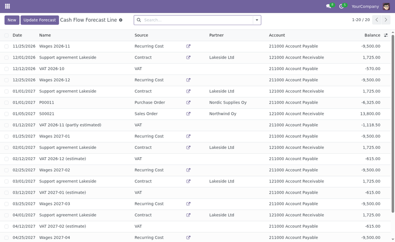
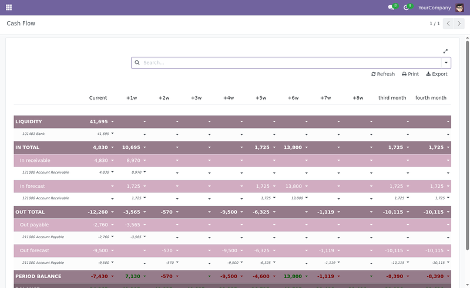

1.  Open *Invoicing \> Reporting \> MIS Reporting \> Cash Flow Forecast
    Line*. The *Update Forecast* button regenerates the lines now; a
    scheduled action does it every night.
    
2.  The *Source* column tells where a line comes from, and the link
    button opens its origin (rule, order or contract).
3.  Open the *Cash Flow* MIS report: the generated lines are in the
    *In forecast* and *Out forecast* rows, by account.
    

A month that already has postings on the accounts of a recurring rule
is not forecast, because those postings already are in the cash flow as
open bills or invoices.
